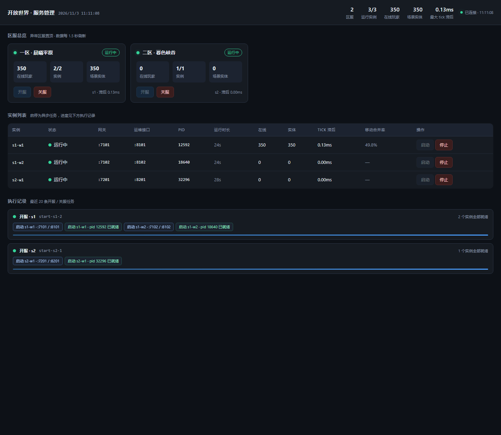

# OpenWorldGameFrame

Go 实现的开放世界游戏服务端框架，含服务管理控制台。

当前进度：**M1 骨架 + M2 场景（AOI / 移动合并 / ECS 组件与 System 管线）+ M3 世界（ID 回收 / Chunk 拓扑 / 跨场景与跨进程迁移 / 节点服务发现 / 世界重分区 / 拓扑对账 / 自动重分区 / 链路优化）+ M4 战斗（技能 + 伤害结算 + Buff + 死亡回收 + 技能树/连招/驱散/暴击/护盾 + 升级系统）+ M5 存档（世界快照 + 拓扑版本持久化 + 玩家档案落库 + 周期批量回写）+ M6 控制平面（单机版 + 审计/RBAC/拓扑热力图 + SSE 增量推送 + 玩家档案接 Redis）+ M6.6 增量对账 + M7 压测调优（5000 人长稳实测）+ **客户端框架（Godot 4.7.2 2D，对接二进制 TCP 协议，连真服务端跑通）+ 客户端玩法 UI（技能目录协议 + 技能树面板 + 小地图）+ M10 玩家档案接 MySQL（最终档案 + Redis 缓存分层）** 已完成并实测**。
设计文档见 [docs/ARCHITECTURE.md](docs/ARCHITECTURE.md)。

---

## 已完成的能力

| 能力 | 状态 |
|---|---|
| TCP 接入、长度前缀帧、连接管理、背压即断开 | ✅ |
| HMAC 无状态登录令牌、会话保持、心跳保活、超时踢人 | ✅ |
| 场景 tick（20Hz）、单写者模型、无锁实体数据 | ✅ |
| AOI 空间索引：格子查询、视野差集、格子尺寸与视野半径可配 | ✅ |
| 实体进出场景、视野内广播（Enter/Leave/State 三类事件） | ✅ |
| 服务端权威移动校验（超速钳制） | ✅ |
| 移动输入写后合并（意图缓冲），每帧工作量以实体数为上界 | ✅ |
| ECS 组件存储（泛型稀疏集）、四阶段 System 管线、panic 隔离 | ✅ |
| 实体 ID 冷却回收：长跑不再推高稀疏数组；耗尽拒绝而非静默涨内存 | ✅ |
| 世界拓扑：Chunk 归属、登录按玩家散列分流、边界对齐校验 | ✅ |
| 跨场景迁移：Prepare/Ready/Commit 三阶段握手，失败回滚，实体数守恒 | ✅ |
| 跨进程迁移：场景分属不同进程，连接不动、实体搬家；ID 按节点分区不撞号 | ✅ |
| 节点间链路：Peer 寻址、手写编解码、连接池、拥塞丢帧不断链 | ✅ |
| 节点服务发现：租约心跳、热加入/退出、掉线自动退出路由（不用重启） | ✅ |
| 世界重分区：整场景在线搬迁（排空实体）+ 死节点地块被接管 | ✅ |
| 拓扑对账：归属版本号 + 定期互换摘要，广播丢了自动补回 | ✅ |
| 自动重分区：每节点按场景数自平衡，相邻优先选块，防振荡硬条件 | ✅ |
| 链路优先级：握手走高优先队列，拥塞只丢数据不丢握手 | ✅ |
| 跨节点下行批量合并：N 次广播合并成一条 MsgClientBatch | ✅ |
| 示例玩法包：属性组件、回血、游荡 AI、脏标记属性同步 | ✅ |
| 战斗管线：技能（CD/AOE）+ 伤害结算（攻防/增伤/减伤）+ Buff（增伤/减伤/中毒/回血）+ 死亡回收 | ✅ |
| 战斗扩展：技能树（前置/等级）+ 连招 + 驱散 + 暴击 + 元素护盾 | ✅ |
| 升级系统：击杀经验 → 等级 → 属性成长 + 技能等级门槛生效 | ✅ |
| 世界存档：实体快照（属性/AI/战斗/Buff）+ 拓扑版本持久化 + 周期/关服落盘 + 重启恢复 | ✅ |
| 玩家档案：属性/战斗按玩家名落库（内存/文件/Redis/MySQL 后端），离场落库、重连恢复 | ✅ |
| 玩家档案周期回写：在线玩家属性变化定期批量落库，进程崩溃丢失窗口可配 | ✅ |
| 玩家档案最终层：MySQL 权威存档（自建表 + upsert）+ Redis 缓存叠层（缓存逐出后从 MySQL 回填），`-mysql-dsn` 一行接入 | ✅ |
| 档案后端统一收口：`persist.Closer` 接口 + `playerStoreComponent`，换后端/叠层都随进程优雅退出释放连接池 | ✅ |
| 拓扑对账增量摘要：稳态只发变化项，定向推送全量兜底 | ✅ |
| `/healthz` `/readyz` `/admin/state` `/metrics` `/admin/drain` `/admin/shutdown` | ✅ |
| 运维审计：危险操作（drain/shutdown/repartition）留痕，`/admin/audit` 可查 | ✅ |
| 运维鉴权：token + 角色分级（只读/运维），探针免鉴权，`-admin-token` 开启 | ✅ |
| 拓扑热力图：`/admin/topo` SVG 渲染 Chunk 归属 + 负载（负载分档着色、不可达灰显） | ✅ |
| 优雅关服四步：摘流 → 通知 → 排水 → 退出 | ✅ |
| 控制平面：七态状态机、进程托管、Saga 编排、异步任务 | ✅ |
| 内置控制台：区服总览、实例列表、开关服、任务进度 | ✅ |
| 控制面重启接管运行中实例（状态落盘 + 探针） | ✅ |
| 控制台 SSE 增量推送（`/api/stream`，零依赖，替代 1.5s 轮询） | ✅ |
| 压测机器人（连接数 / 发包频率 / 时长、沿轴横穿边界） | ✅ |
| 客户端框架：Godot 4.7.2 2D，对接二进制 TCP 协议，HMAC 登录+进场景+移动+攻击+心跳全链路跑通 | ✅ |
| 客户端技能目录协议：C2S_QUERY_SKILLS / S2C_SKILL_LIST（经场景 goroutine 安全下发，含已解锁位图） | ✅ |
| 客户端技能树面板：真实技能数据、按"可用/已学·等级不足/锁定"三态着色、点击切换施法技能 | ✅ |
| 客户端小地图：以自己为中心投影视野实体（复用 EntityState 广播） | ✅ |
| etcd 适配器 | ⬜ 见里程碑 |

---

## 快速开始

### 构建

```bash
go build -o bin/server.exe ./cmd/server     # 业务节点
go build -o bin/control.exe ./cmd/control   # 控制面
go build -o bin/bot.exe ./tools/bot         # 压测机器人
```

### 方式一：控制台托管（推荐）

```bash
./bin/control.exe -addr :9000 -config configs/zones.json
```

打开 <http://127.0.0.1:9000/>，在区服卡片上点「开服」。

控制面会按 `configs/zones.json` 拉起真实的 `server.exe` 子进程，分配端口，健康探测，把在线数、实体数、tick 滞后汇总到页面上。



关服不是杀进程。点「关服」后走四步：

1. **摘流** —— 网关拒绝新登录，`/readyz` 返回 503
2. **通知** —— 给所有在线玩家推关服提示（`S2C_Notice`，带倒计时秒数）
3. **排水** —— 等倒计时走完，再踢线
4. **退出** —— `POST /admin/shutdown` 让进程自己收尾，超时才强杀

日志里能看到每一步：

```
level=WARN msg="drain requested via admin api" graceSeconds=5
level=WARN msg="gate draining" grace=5s notified=300
level=WARN msg="gate kicked all sessions" count=300 reason="server maintenance"
level=WARN msg="shutdown requested" reason="admin request"
```

### 方式二：直接跑单个节点（调试用）

```bash
./bin/server.exe -gate-addr :7001 -admin-addr :7002

# 顺便刷 2000 只怪，看 ECS 玩法层跑起来
./bin/server.exe -gate-addr :7001 -admin-addr :7002 -mobs 2000

# 三个场景横着排（0/512/1024/1536），每个场景 200 只怪，用来验证跨场景迁移
./bin/server.exe -gate-addr :7001 -admin-addr :7002 -partition 1x3 -scene-size 512 -mobs 200
```

### 方式三：多进程世界（跨进程迁移）

两个进程各持一部分场景，玩家从一个 Gate 进来，走到隔壁场景时实体搬到另一个进程，连接不动：

```bash
# 节点 n1：场景 1；节点 n2：场景 2、3。拓扑见 configs/world-2node.json
./bin/server.exe -node n1 -node-addr 127.0.0.1:7003 -world configs/world-2node.json \
  -gate-addr :7001 -admin-addr :7002 -mobs 100
./bin/server.exe -node n2 -node-addr 127.0.0.1:7103 -world configs/world-2node.json \
  -gate-addr :7101 -admin-addr :7102 -mobs 100
```

`-world` 是一份**所有节点内容相同**的全局拓扑：自己的场景建出来，别人的场景只登记边界。`-node-addr` 是节点间链路，`-node` 必须与配置里的节点名一致。

三个组件按 `mesh → discovery → scene → gate → admin` 顺序启动，关闭时逆序执行。

### 方式四：节点热加入（服务发现）

上一种方式里，成员表写死在配置里：少起一个节点，玩家走到那块边界就过不去（而且在 M3.3 里会不停重试超时）。加上 `-disc file` 之后，**成员由心跳决定**，节点可以随时来去，已经在跑的节点不用重启：

```bash
# 三个节点共用一份拓扑（configs/world-3node.json）+ 一个注册目录
./bin/server.exe -node n1 -node-addr 127.0.0.1:7003 -world configs/world-3node.json \
  -gate-addr :7001 -admin-addr :7002 -disc file -disc-dir run/nodes
# 过一会儿再起 n2 / n3，n1 的日志会出现 joined=[n2 n3]，路由自动扩到那两块地
./bin/server.exe -node n2 -node-addr 127.0.0.1:7103 -world configs/world-3node.json \
  -gate-addr :7101 -admin-addr :7102 -disc file -disc-dir run/nodes
# kill -9 n3，3 秒内 n1/n2 的日志出现 lost=[n3]，玩家走到 x=1024 被夹住（不会反复超时）
```

`-disc static`（默认）保持原来的行为：成员就是配置里声明的节点。`-disc file` 的注册目录必须是所有节点都能读写的同一份（本机多进程、或共享卷）；跨机房要换 etcd，接口已经抽好，但适配器还没写。
`-mobs` 生成的怪会带属性组件和游荡 AI：出生 60% 血、每秒回 2%、走到附近会看到血条变化（`S2C_EntityAttr`）。

### 方式五：自动重分区（负载自平衡）

加 `-auto-rebalance` 之后，每节点自己看着拓扑：发现自己持有的场景数超过公平份额（`ceil(总数/活节点)`）就搬一块给最空的活节点。不用人盯，不会左右横跳：

```bash
# configs/world-5scene-3node.json 故意让 n1 持 3 块、n2/n3 各 1 块
./bin/server.exe -node n1 -node-addr 127.0.0.1:7003 -world configs/world-5scene-3node.json \
  -gate-addr :7001 -admin-addr :7002 -disc file -disc-dir run/m37/nodes \
  -auto-rebalance -rebalance-eval 3s -mobs 100
./bin/server.exe -node n2 -node-addr 127.0.0.1:7103 -world configs/world-5scene-3node.json \
  -gate-addr :7101 -admin-addr :7102 -disc file -disc-dir run/m37/nodes \
  -auto-rebalance -rebalance-eval 3s -mobs 100
./bin/server.exe -node n3 -node-addr 127.0.0.1:7203 -world configs/world-5scene-3node.json \
  -gate-addr :7201 -admin-addr :7202 -disc file -disc-dir run/m37/nodes \
  -auto-rebalance -rebalance-eval 3s -mobs 100
# 三节点互发现后约 13s，n1 日志出现 auto-rebalance move scene=3 to=n2，
# 190ms 后 n1=2、n2=2、n3=1，不再有第二次搬迁（防振荡硬条件）。
```

只搬活主人手里**自己**的超载场景；死节点的地不自动接管。`/admin/state` 的 `scheduler` 字段能看到 `evaluations / attempted / succeeded / rejected / lastDecision`。

### 玩家档案接 MySQL（M10）

```bash
# MySQL 最终档案 + Redis 在线缓存（两者都配 → LayeredStore，日志会打
# "player records on mysql (final) + redis (cache)"）
./bin/server.exe \
  -mysql-dsn "root@tcp(127.0.0.1:3306)/openworld?parseTime=true" \
  -redis-addr 127.0.0.1:6379 -redis-prefix "player:" \
  -gate-addr :7001 -admin-addr :7002

# 只用 MySQL，不叠缓存
./bin/server.exe -mysql-dsn "root@tcp(127.0.0.1:3306)/openworld?parseTime=true" \
  -gate-addr :7001 -admin-addr :7002
```

表 `player_records(player, data, updated_at)` 在启动时自建，无需迁移脚本；落库走
`INSERT ... ON DUPLICATE KEY UPDATE` 幂等覆盖。玩家离场时精确落最后一笔，在线期间每
`-save-players-interval` 批量回写一次兜底。缓存被逐出后下次进场会从 MySQL 读回并回填 Redis。

### 压测

```bash
# 300 个机器人，10Hz 移动，跑 20 秒
./bin/bot.exe -n 300 -addr 127.0.0.1:7001 -duration 20s -rampup 2ms

# 400 个机器人，40Hz 移动（是 tick 频率的 2 倍，用来观察合并率）
./bin/bot.exe -n 400 -addr 127.0.0.1:7001 -duration 40s -rampup 1ms -move 25ms

# 沿 X 轴来回走，反复穿越场景边界（配合 -partition 1x3 用）
./bin/bot.exe -n 300 -addr 127.0.0.1:7001 -duration 60s -move 100ms -walk x -min-x 40 -max-x 1500

# 边跑边打怪（-attack），压测战斗管线：技能 / 伤害结算 / 击杀回收
./bin/bot.exe -n 100 -addr 127.0.0.1:7001 -duration 25s -move 100ms -walk x -min-x 10 -max-x 1500 -attack
```

### 看状态

```bash
curl http://127.0.0.1:7002/healthz          # 存活
curl http://127.0.0.1:7002/readyz           # 就绪（排水期间返回 503）
curl http://127.0.0.1:7002/admin/state      # 完整状态快照
curl http://127.0.0.1:7002/metrics          # Prometheus 指标

curl -X POST 'http://127.0.0.1:7002/admin/drain?grace=10'  # 排水，10 秒倒计时
curl -X POST http://127.0.0.1:7002/admin/shutdown          # 优雅退出
```

> **Windows 本机注意**：Git Bash 里的 `curl` 实测返回空，统一改用 PowerShell：
> ```powershell
> (Invoke-WebRequest -Uri http://127.0.0.1:7002/admin/state -UseBasicParsing).Content
> Invoke-WebRequest -Uri http://127.0.0.1:7002/admin/shutdown -Method POST -UseBasicParsing
> ```

### 测试

```bash
go test ./internal/... ./pkg/...
go test ./internal/world -bench BenchmarkMoveBroadcast -benchtime 1s
```

---

## 控制面 API

```
GET    /                              内置控制台
GET    /api/healthz
GET    /api/overview                  区服 + 实例 + 最近任务
GET    /api/tasks                     任务列表
GET    /api/tasks/{id}                单任务进度
POST   /api/zones/{id}/start          开服
POST   /api/zones/{id}/stop?grace=10  优雅关服
POST   /api/instances/{id}/start      单实例启动
POST   /api/instances/{id}/stop       单实例停止
```

开关服一律返回 `202 + taskId`，前端轮询进度。同一区服同一操作进行中时重复调用返回同一个 taskId。

### 业务节点运维接口（每个节点的 `-admin-addr`）

```
GET  /healthz   /readyz   /metrics   /admin/state
POST /admin/drain?grace=300     摘流排水
POST /admin/shutdown            优雅退出
POST /admin/repartition?scene=3&to=n1   把一块地搬到另一个节点
```

重分区返回 `202`（搬迁是异步的：要排空实体、两次握手），进度看 `/admin/state` 里对应场景的 `move` 字段（`to / phase / moved / total`）。

---

## 参数

### 业务节点 `server.exe`

| 参数 | 默认值 | 说明 |
|---|---|---|
| `-gate-addr` | `:7001` | 网关监听地址 |
| `-admin-addr` | `:7002` | 运维接口地址，**生产环境必须绑内网** |
| `-secret` | `dev-secret-change-me` | 令牌签名密钥，客户端必须一致 |
| `-tick-ms` | `50` | 逻辑帧间隔，50ms = 20Hz |
| `-token-ttl` | `5m` | 令牌有效期 |
| `-instance-id` | 空 | 由控制面注入，用于状态上报 |
| `-zone` | 空 | 由控制面注入 |
| `-mobs` | `0` | **每个场景**生成的怪物数量，演示 ECS 玩法层（2000 只约 0.2% 帧预算） |
| `-partition` | `1x1` | 世界拓扑「行x列」，例如 `1x3` 表示一行三个场景；场景按网格自动铺边 |
| `-scene-size` | `512` | 每个场景的边长（米），必须是 512m（Chunk）的整数倍，否则拓扑拒绝装载 |
| `-world` | 空 | 世界拓扑配置文件；配置后 `-partition` / `-scene-size` 失效，走多进程模式 |
| `-node` | 空 | 本节点标识，多进程部署必填，需与 `-world` 配置里的节点名一致 |
| `-node-addr` | 空 | 节点间链路监听地址（如 `:7003`）；为空表示不参与跨进程 |
| `-node-advertise` | 由 `-node-addr` 推导 | 注册到发现中心的地址；监听 `0.0.0.0`/`:` 时必须显式给出可拨号地址 |
| `-disc` | `static` | 节点发现方式：`static`（成员写死在 `-world` 里）/ `file`（共享目录心跳） |
| `-disc-dir` | 空 | `file` 方式的共享目录，例如 `run/nodes` |
| `-disc-ttl` | `3s` | 记录过期时间；进程被 `kill -9` 后，邻居最迟在这个时间之后把它判死 |
| `-auto-rebalance` | `false` | 开启自动重分区：每节点按场景数自平衡，只搬自己拥有的地（M3.7） |
| `-rebalance-eval` | `5s` | 自动重分区的评估周期 |
| `-rebalance-cooldown` | `15s` | 同一场景两次搬迁的最小间隔，需大于一次搬迁耗时（~300ms） |
| `-rebalance-slack` | `0` | 允许超出公平份额的场景数；0 表示严格按 `ceil(总数/活节点)` 收敛 |
| `-save-dir` | 空 | 存档目录；为空表示不落盘。存拓扑归属+版本号+怪物实体，每节点一份 `world-save-<node>.json` |
| `-save-interval` | `30s` | 周期存档间隔（需配合 `-save-dir`） |
| `-admin-token` | 空 | 运维接口鉴权 token；为空表示开发模式（所有 `/admin/*` 开放）。配了之后写接口要 token，探针仍免鉴权 |
| `-save-players` | 空 | 玩家档案目录；为空表示不落玩家档案。离场落库、重连恢复血量等级，跨进程/跨区可迁移 |
| `-save-players-interval` | `10s` | 玩家档案周期回写间隔；配合 `-save-players`，把在线玩家的属性变化定期落盘，缩小进程崩溃时的丢失窗口 |
| `-redis-addr` | 空 | 玩家档案的 Redis 地址（host:port）。单独配置时作档案存储；与 `-mysql-dsn` 同时配置时自动降为在线缓存层，由 `LayeredStore` 叠在 MySQL 之上 |
| `-redis-password` | 空 | Redis 密码；无密码留空 |
| `-redis-db` | `0` | Redis 数据库编号 |
| `-redis-prefix` | `player:` | 玩家档案在 Redis 里的键前缀，避免和其他数据冲突 |
| `-mysql-dsn` | 空 | 玩家档案的 MySQL DSN（M10），如 `root@tcp(127.0.0.1:3306)/openworld?parseTime=true`。构造时 Ping + 自建 `player_records` 表；优先级 `MySQL+Redis → 分层` > 仅 MySQL > 仅 Redis > `-save-players` > 不落 |
| `-log-level` | `info` | debug / info / warn / error |

### 控制面 `control.exe`

| 参数 | 默认值 | 说明 |
|---|---|---|
| `-addr` | `:9000` | 控制台与 API 的监听地址 |
| `-config` | `configs/zones.json` | 区服配置 |
| `-probe-seconds` | `2` | 实例健康探测间隔 |
| `-log-level` | `info` | |

区服配置见 `configs/zones.json`：每个区服声明实例数和起始端口，实例 `i` 用 `起始端口+i` 做网关、`起始端口+1000+i` 做运维接口。

---

## 目录结构

```
cmd/
  server/            业务节点入口（gate + world + admin 同进程）
  control/           控制面入口
internal/
  core/              服务容器：组件注册、有序启动、逆序停止、失败回滚、主动退出
  net/               TCP 接入、帧编解码、连接与发送队列（客户端 / 节点共用）
  protocol/          线协议：消息 ID、二进制读写、消息编解码
  gate/              鉴权、会话、消息分发、排水
    peer.go          远端会话代理：下行回写、上行转发、路由改写
  aoi/               空间索引：格子查询、视野遍历、差集判断
  ecs/               组件存储：泛型稀疏集池、多组件交集查询、Store
  world/             场景、实体、tick 循环、意图缓冲、视野同步、System 管线
    topology.go      Chunk → 全局节点地址 的映射表
    config.go        多节点拓扑配置加载（节点表、场景归属、ID 分区）
    transfer.go      跨场景 / 跨进程三阶段迁移
    repartition.go   世界重分区：整场景搬迁（排空）、死节点接管
    reconcile.go     拓扑对账：版本比较、摘要互换、冲突裁决、退休本地副本
    scheduler.go     自动重分区调度：每节点按场景数自平衡、相邻优先、防振荡
    peer.go          节点间消息分发（准入、提交、转发、ID 归还、场景控制）
  mesh/              节点间链路：连接池、拥塞丢帧、双优先级队列、下行批量合并
  discovery/         成员租约：Register/Watch、共享目录心跳（static / file）
  game/creature/     参考玩法包：属性、回血、游荡 AI、属性同步
  game/combat/       战斗：技能、伤害结算、Buff、死亡处理
  game/player/       玩家档案聚合：进场恢复、离场落库、周期回写
  persist/           档案后端：Store/Closer 接口、Memory/File/Redis/MySQL/Layered 实现
  control/           控制面：状态机、注册表、进程托管、编排、落盘
    web/             内嵌控制台（单文件 HTML）
  observability/     指标注册表、运维 HTTP 接口
pkg/authtoken/       登录令牌签发与验签
tools/bot/           压测机器人
configs/zones.json   区服（控制面托管）配置
configs/world-2node.json  两节点世界拓扑（M3.3 实测）
configs/world-3node.json  三节点世界拓扑：固定 ID 槽位、支持热加入（M3.4）
logs/                实例日志 + 控制面状态快照
docs/ARCHITECTURE.md 架构设计
```

---

## 线协议

大端序，帧头 6 字节：

```
+----------+----------+----------------+
| len u32  | msgID u16| body (len-2)   |
+----------+----------+----------------+
```

`len` 包含 `msgID`，不含 `len` 自身。单帧上限 64KB。
当前用手写二进制编解码（零依赖、零反射），后续换 protobuf 只需替换 codec。

消息流：

```
客户端                        Gate                    Scene
  │── C2S_Login ──────────────▶│ 验签                     │
  │◀─ S2C_LoginResp ───────────│                          │
  │── C2S_EnterScene ─────────▶│─────────────────────────▶│ 分配实体
  │◀─ S2C_EnterScene ──────────│◀─────────────────────────│
  │◀─ S2C_EntityEnter ─────────│◀─ 周围实体 ──────────────│
  │── C2S_Move ───────────────▶│──── 写入意图缓冲 ───────▶│ 帧内合并后结算
  │◀─ S2C_EntityState ─────────│◀─ 广播给邻居 ────────────│
  │── C2S_Heartbeat ──────────▶│─────────────────────────▶│ 刷新存活
  │◀─ S2C_EntityAttr ─────────│◀─ 组件脏了才发（1Hz）────│ ECS 属性同步
  │── C2S_Attack ─────────────▶│──── 走 mailbox 串行 ─────▶│ 伤害结算 + 击杀
  │◀─ S2C_CombatHit ──────────│◀─ 广播给目标视野内玩家 ───│ 战斗结算结果
  │◀─ S2C_Notice ──────────────│◀─ 关服倒计时（排水时）───│
```

17 条消息：Login / LoginResp / Heartbeat / HeartbeatResp / EnterScene / EnterSceneResp /
Move / EntityState / EntityEnter / EntityLeave / EntityAttr / Kick / Notice / Attack / CombatHit /
QuerySkills / SkillList。

位置走 20Hz 增量（`EntityState`），属性走"变化时 1Hz"（`EntityAttr`）。两者分开是因为
位置是连续量、必须高频；属性是离散量、跳变才需要通知。混在一条消息里会让属性被迫
跟着位置一起高频发。攻击（`C2S_Attack`）只带目标 ID 和技能 ID，不带伤害数值——伤害
由服务端按攻击方属性、技能系数、Buff 和防御方减伤统一结算，客户端只表达意图。

---

## 实测数据

### 1000 并发机器人（单进程单场景）

| 指标 | 数值 |
|---|---|
| 登录成功率 | 1000/1000，0 失败 |
| 实体状态包 | 1,019,382 |
| 心跳往返 | 51ms（M1 同负载为 157ms） |
| tick 抖动 | 0.13ms |
| 消息丢弃 | 0 |
| 堆内存 | 12 MB |
| goroutine | 2008（1000 连接 × 2 协程） |

### 400 机器人 @ 40Hz 移动（验证写后合并）

| 指标 | 数值 |
|---|---|
| 在线 | 400/400，零失败 |
| 移动意图 | 188,905 |
| 实际结算 | 75,935 |
| 合并率 | **51.4%** |
| tick 滞后 | 0.13ms |
| 消息丢弃 | 0 |

### 单条位移的处理成本（含视野广播，单核 i5-7500）

| 分布 | M1 九宫格 | M2 AOI | 提升 |
|---|---|---|---|
| 2000 人散落 1000m | 1.42 µs | ≈460 ns | 3.1× |
| 2000 人集中 300m | 5.31 µs | ≈1.4 µs | 3.8× |
| 2000 人挤 100m 主城 | 54.2 µs | ≈5.5 µs | 9.9× |

主城那 9.9× 要拆开看：其中 3.4× 来自代码（slice 连续遍历 + 零分配求差集），2.9× 来自把视野从 96m 缩到 48m——后者是玩法取舍，不是实现能力。

复现：`go test ./internal/world -bench 'BenchmarkMoveBroadcast|BenchmarkMoveIntake' -benchtime 1s`

> 这台机器是 4 核开发机，同机压测时 bot 和 server 抢核，数字有 ±20% 抖动。量级可信，小数点不可信。

### ECS 玩法层的成本（2000 只怪挂 AI，单核 i5-7500）

| 场景 | 单帧耗时 | 占 50ms 帧预算 |
|---|---|---|
| 2000 怪 · 只有移动 | 30 µs | 0.06% |
| 2000 怪 · AI + 回血 + 属性同步 | 88 µs | 0.18% |
| 5000 怪 · AI + 回血 + 属性同步 | 252 µs | 0.50% |
| 组件挂载 + 卸载（2 个组件） | 33 ns | — |

复现：`go test ./internal/game/creature -bench . -benchtime 100ms`

端到端（同机跑 1000 个机器人）：

| 场景 | 平均 RTT | 结果 |
|---|---|---|
| 1000 玩家 + 0 怪 | 38 ms | 0 失败、0 丢弃 |
| 1000 玩家 + 2000 怪 | 66 ms | 0 失败、0 丢弃、0 panic |
| 500 玩家 + 2000 怪 | 21 ms | 1.04M 状态包 / 20 秒 |
| 0 玩家 + 2000 怪 | — | 服务端 CPU ≈ 0% |

最后一行是这套设计的关键结论：**没有玩家在视野里时，2000 只怪的 AI、位移、索引维护几乎不花 CPU**。怪物的成本 = 怪物数 × 视野内玩家数，是广播放大器，不是计算放大器。

属性包只在变化时下发：2000 只怪从 60% 血回满的前 5 秒产生约 11k 包/秒，回满之后归零（`attrSyncs` 不再增长）。

### 实体 ID 回收（M3.1）

组件池用实体 ID 直接下标寻址，所以 `sparse` 数组长度 = 历史最大 ID。ID 不复用的话它会随累计实体数一直涨。回收策略：释放后冷却 2 秒（覆盖任何在途旧包的寿命）再复用。

单测对照（同一段代码，只改冷却策略，累计 2 万次生灭、峰值 2000）：

| 实验臂 | ID 高水位 | sparse 长度 | 每池寻址内存 |
|---|---|---|---|
| 不回收 | 20000 | 32752 | 127 KB |
| 回收 | 2000 | 2032 | 7 KB |

端到端（2000 只怪常驻，前后 6 轮各 400~500 个机器人登录再断开）：

| 时刻 | ID 高水位 | 复用次数 |
|---|---|---|
| 只有 2000 怪 | 2000 | 0 |
| 3 轮之后 | 2497 | 880 |
| 6 轮之后 | 2497 | 2169 |

第 3 轮和第 6 轮的高水位完全一样——再多的进出也不再推高水位。分配开销：新号 37 ns、复用 64 ns，均 0 分配。

复现：`go test ./internal/world -run 'TestSparseArrayGrowth' -v`、`go test ./internal/world -bench 'IDAlloc'`

### 跨场景迁移（M3.2）

3 个场景（1×3，每个 512m 见方，边界落在 0 / 512 / 1024 / 1536）× 200 只怪，300 个机器人在 x∈[40,1500] 来回走，反复穿越两条边界：

| 指标 | 数值 |
|---|---|
| 登录成功 | 300 / 300，失败 0、丢弃 0 |
| 迁移（服务端迁出 / 迁入） | 105 / 105，**完全配平** |
| 迁移失败 / 超时 | 0 / 0 |
| 客户端观测到的场景切换 | 105，与迁出数一一对应 |
| 结束后各场景实体数 | 200 / 200 / 200，总量守恒 |
| 位移包 / 被超速钳制 | 512,536 / 15（0.003%） |
| tick 滞后 | 0.13 ms |
| 平均 RTT | 3.9 ms |

玩家跨过 512 时，客户端只收到一条 `EnterSceneResp`，看不到任何"换服"动作——三阶段握手（Prepare → Ready → Commit）把实体摘除、状态搬迁、会话切换全部收在一个 tick 级别的窗口里。

那 15 次钳制全在刚落地那一帧：摘除实体时意图缓冲里最多一两个包跟着丢了，落地后第一包要一次补回来，正好越过速度上限。下一次状态包会把客户端位置纠正过来，不值得为它加"跨场景搬运意图"的复杂度。

复现：

```bash
./bin/server.exe -partition 1x3 -scene-size 512 -mobs 200
./bin/bot.exe -n 300 -duration 60s -move 100ms -walk x -min-x 40 -max-x 1500
```

跑完看 `http://127.0.0.1:7002/admin/state` 里的 `world.scenes[].handoversOut / handoversIn`。

### 跨进程迁移（M3.3）

两个进程：n1 持场景 1，n2 持场景 2、3；400 个机器人分两批从两个 Gate 接入，沿 X 轴来回穿越：

| 指标 | 数值 |
|---|---|
| 登录成功 | 400 / 400，失败 0 |
| 迁移（迁出 / 迁入） | 149 / 149，**完全配平** |
| 迁移失败 / 超时 | 0 / 0 |
| 客户端观测到的场景切换 | 149，与迁出数一一对应 |
| 结束后各场景实体数 | 100 / 100 / 100，总量守恒 |
| 节点间帧数 | 28,739 / 73,518（n1 发/收） |
| 队满丢帧 / 发送失败 / 拨号失败 | 0 / 0 / 0 |
| 节点日志告警 | 0 |
| 平均 RTT | 14.3 ms（n1 侧）/ 26.8 ms（n2 侧） |

玩家的 socket 一直挂在接入节点上，实体搬走之后下行包经节点链路回传、上行消息经节点链路转发——客户端只看到一条 `EnterSceneResp`，感知不到自己换了进程。

RTT 高于单进程的 3.9ms，主要是同机 4 个进程抢 4 核（其中两个是 400 机器人的压测进程），不是链路本身的成本。

**ID 账目是平的**：n1 的 200 个玩家 ID 全部回到冷却队列（`live` 只剩 100 只怪），n2 记下 100 个"外来 ID"并且都通知了 n1 回收。跨进程之后 M3.1 的回收机制没有失效。

复现：

```bash
./bin/server.exe -node n1 -node-addr 127.0.0.1:7003 -world configs/world-2node.json -gate-addr :7001 -admin-addr :7002 -mobs 100
./bin/server.exe -node n2 -node-addr 127.0.0.1:7103 -world configs/world-2node.json -gate-addr :7101 -admin-addr :7102 -mobs 100
./bin/bot.exe -n 200 -addr 127.0.0.1:7001 -duration 60s -move 100ms -walk x -min-x 40 -max-x 1500
./bin/bot.exe -n 200 -addr 127.0.0.1:7101 -duration 60s -move 100ms -walk x -min-x 40 -max-x 1500
```

### 节点热加入与掉线（M3.4）

n1 先单独跑起来，n2/n3 中途启动，再 `kill -9` 掉 n3，最后把它拉回来。**n1 全程没有重启**（连续在线 173 秒）：

| 阶段 | 操作 | 结果 |
|---|---|---|
| 邻居缺席 | 只有 n1，100 机器人 15s | 登录 100/100、可达地块 1/3、切场景 **0**、迁移失败 **0**（根本不去尝试） |
| 热加入 | n2/n3 后起 | n1 日志 `joined=[n2 n3]`、可达地块 1→3；240 机器人 30s：登录 240/240、迁出 50 / 迁入 50、失败 0、实体 100/100/100 |
| 崩溃 | `kill -9` n3 | n1 **2.7s**、n2 **3.1s** 发现 `lost=[n3]`、可达地块 3→2；之后 80 机器人 20s：切场景 0、迁移失败 **0**、边界阻塞 +1616 |
| 归队 | 重启 n3 | 4s 内 `joined=[n3]`、可达地块 2→3 |

阶段三是最能说明问题的一行：**掉线的邻居不会产生失败的迁移，只会变成一堵墙**。如果只做注册不做路由投影，玩家会在边界上每帧发一次 Prepare、3 秒超时、再发——日志刷满，人卡在原地抖。

三个节点全程 `dropped=0 / sendFail=0 / dialFail=0`，RTT 1.0~2.0ms；优雅关停后注册目录自动变空。细节见 [docs/ARCHITECTURE.md](docs/ARCHITECTURE.md) 6.10。

### 世界重分区（M3.5）

一块地可以在线换主人，玩家跟着走。两种动作：**搬迁**（主人活着，地上有人，要一个个搬过去）和**接管**（主人死了，实体随进程消失，只改拓扑）。

| 阶段 | 操作 | 结果 |
|---|---|---|
| 搬迁 | n3 的 scene3（169 实体）交给 n1 | **223ms** 完成：prepare 21ms → 排空 169 人 113ms → 切换 27ms；失败 0 |
| 崩溃接管 | `kill -9` n1，n2 自接它留下的 scene3 | 100 只怪重新填充（地上已无人），三节点 `s3@n2` 一致 |
| 第三方接管 | 由 n2 发起，把 n1 的 scene1 交给 n3 | **509ms**（含一次向死节点拨号失败），两边 `s1@n3` 一致 |
| 接管后通行 | 60 机器人从 n2 走进两块接管地 | 登录 60/60、切场景 10、迁移失败 0、`moveBlocked=0` |

最后一行是关键：接管完不只是"拓扑说这地有主了"，而是**玩家真的能走进去**——`moveBlocked=0` 说明没有人被夹在边界上。细节见 [docs/ARCHITECTURE.md](docs/ARCHITECTURE.md) 6.11。

### 拓扑对账（M3.6）

重分区靠一条广播告知全网，而广播会丢。**漏收的节点没有任何办法知道自己漏了**——它手里那份拓扑和别人的长得一样合理，只是旧了。后果不是报错，是玩家走到那块边界时 Admit 投给一个已经没有这个场景的节点，3 秒超时后被夹住。

修法是给拓扑一个可比的东西：每块地一个归属版本号（只在换主人时 +1），每 2 秒互换一次整份摘要，谁新谁赢。

实测里最能说明问题的一步是**重启归队**：

| 阶段 | 操作 | 结果 |
|---|---|---|
| 错过两条广播 | n2 挂掉期间，n1 拿走 scene3、n3 接管 scene2 | n2 毫不知情 |
| 重启 | n2 按配置重建 scene2（100 只怪） | **37ms** 后收到 n1 的摘要，`applied=2`：`scene2@n3 ver=1`、`scene3@n1 ver=1` |
| 退休 | 把那份副本停掉 | 57ms 时 `scene purged entities=100`，`retired=1`；三节点 `chunks` 再次完全一致 |
| ID 账目 | 退休之后 | `live=0 / cooling=100` —— 100 个怪 ID 全部回收，没有泄漏 |
| 通行 | 60 机器人从 n3 来回穿越两块地 30s | 登录 60/60、切场景 19、迁移失败 0、`moveBlocked=0` |

37 毫秒这个数字有点反直觉：**对账比广播先到**。因为 n3 的广播是串行发的，先给已经死掉的 n2 拨号，失败路径卡了近 1 秒，排在后面的 n1 反而先收到了周期性摘要。所以顺手改成"已经判死的节点不发广播"。细节见 [docs/ARCHITECTURE.md](docs/ARCHITECTURE.md) 6.12。

### 自动重分区（M3.7）

M3.5 之后"搬一块地"是手动 `POST /admin/repartition?scene=&to=`，M3.6 保证大家的拓扑看法一致，但**什么时候该搬、搬到哪**还是得人盯。一个节点挂掉被接管之后，剩下的地就一直歪着。M3.7 让每个节点自己看着拓扑，**只动自己拥有的地**，把过载的那块搬到最空的活节点上。

决策只往一个方向走——"减少最大持有数"，而且加了"搬过去之后目标不能变成新的最大"这条硬条件，所以不会左右横跳：

| 阶段 | 操作 | 结果 |
|---|---|---|
| 制造不均衡 | `configs/world-5scene-3node.json`：n1 持 3 块（300 实体）、n2/n3 各 1 块 | 公平份额 ceil(5/3)=2，n1 超载 1 块 |
| 首次评估（+13s） | n1 调度器发现超载，选与 n2 相邻的 scene3 | `auto-rebalance move scene=3 to=n2 ents=100 from=3 fair=2` |
| 搬迁落地 | 排空 100 实体 + Activate + 退休 | **190ms**（决策到退休）；n2 `scene adopted` `handIn=108`（100 搬入 + 8 穿越迁入） |
| 收敛 | n1=2、n2=2、n3=1，实体各 100 守恒 | 三节点拓扑一致；之后 5 个评估周期 `attempted` 不再增长 |
| 通行验证 | 40 机器人沿 X 轴穿越 5 场景 25s | `logined=40 failed=0 sceneSwitches=11 handoverFails=0 moveBlocked=0 avgRTT=1.9ms` |

只搬活主人手里**自己**的超载场景；死节点的地不自动接管（主人可能只是网络分区，自动接管会和回来后的主人撞车），留给显式触发。细节见 [docs/ARCHITECTURE.md](docs/ARCHITECTURE.md) 6.13。

---

## AOI 参数

默认 **16m 格 / 3×3 = 48m 见方视野**。实体移动时只重算新旧视野的差集，
跨格才触发 Enter/Leave，视野内的位置更新走一次广播。

```go
scene := world.NewScene(1, 50*time.Millisecond, metrics, logger,
    world.WithAOI(8, 2)) // 8m 格 + 5×5 = 40m 视野
```

调参经验：

- **视野是最大的性能杠杆**。96m → 48m 让主城密度的单条位移快 2.9 倍，因为邻域人数减到 1/4。
- **格子尺寸影响遍历效率，不影响正确性**。小格子让每格实体更少、遍历更快，但格子数量变多。
- 视野范围 = `cellSize × (2 × radius + 1)`，两个参数要一起看。

---

## 容量上限

移动改走意图缓冲后，每帧最多结算「实体数」次位移，与客户端发包频率无关。
所以容量上限只剩一个变量：**玩家密度**。

| 分布 | 每格人数 | 单条位移 | 半帧（25ms）可支撑 |
|---|---|---|---|
| 散落 1000m | ~0.5 | ≈460 ns | 约 5.5 万 |
| 集中 300m | ~5.6 | ≈1.4 µs | 约 1.8 万 |
| 主城 100m | ~51 | ≈5.5 µs | 约 4500 |

主城密度是唯一撑不住的场景，靠 AOI 参数调优仍然不够——需要**主城分线**或**分场景**。这就是 M3 的动机。

---

## 世界拓扑

`-partition 1x3 -scene-size 512` 把世界切成三块，边角落 0 / 512 / 1024 / 1536：

```
        x=0        x=512      x=1024     x=1536
         ├──────────┼──────────┼──────────┤
  z=512  │ scene 1  │ scene 2  │ scene 3  │
         └──────────┴──────────┴──────────┘
```

两条规则决定了整套设计：

1. **Chunk（512m）是归属单位，AOI 格（16m）是广播单位，两者解耦**。场景边界必须落在 Chunk 边界上，否则一个 Chunk 会横跨两个场景，`Route` 只能二选一，另一边的玩家每帧都会发起一次迁移，表现为在边界上原地抖动。拓扑加载时会校验对齐，不对齐直接拒绝。
2. **实体 ID 属于世界，不属于场景**。迁移要保留原 ID（客户端靠它认自己的角色），如果每个场景各有一份分配器，就必须回答"外来 ID 谁回收"，而这个问题的任何答案都会引出一类撞号或泄漏。把 ID 空间上移一层，问题直接不存在。

登录时按玩家名散列选场景 + 稳定落点，所以 300 个玩家会均匀落在三个场景，而不是全挤进默认场景——拓扑只在"玩家走过去"时生效的话，登录洪峰照样能把第一个场景打满。

跨界迁移是三阶段握手（Prepare → Ready → Commit，3 秒超时）：先问对方能不能收，再摘除自己这边，最后搬状态落地。**必须先问再摘**——先摘了再被拒绝，就得把刚删掉的人连位置带组件重建回来，而这段时间玩家是"消失"的。失败的三条路径（对方拒绝 / 对方不回 / Commit 投递失败）都有明确归宿，最长的那条会原地重建。细节见 [docs/ARCHITECTURE.md](docs/ARCHITECTURE.md) 6.8。

### 跨进程

拓扑里的归属不只是场景号，而是 `(节点, 场景)`。多进程部署时每个节点加载同一份 `configs/world-2node.json`：自己的场景建出来，别人的只登记边界。玩家走到属于别的进程的地，三阶段握手原样跑一遍，只是消息走节点间链路。

**连接不跟着实体走**：玩家的 TCP 连在接入节点上（连接不能跨进程搬），实体搬到哪，下行包就从哪经链路回传到接入节点再写 socket，上行消息反过来转发。客户端只看到一条 `EnterSceneResp`。

实体 ID 按节点做**步长分区**（`id = seq × 步长 + 槽位`），不同节点的 ID 落在不同的同余类上，物理上不会撞号；实体在别的节点死掉时发一条 `MsgReleaseID` 让所有者回收，回收机制不因跨进程失效。细节见 [docs/ARCHITECTURE.md](docs/ARCHITECTURE.md) 6.9。

步长取的是"槽位上限"（`maxNodes`）而不是"当前节点数"，槽位在配置里写死。理由是一个具体的反例：节点数从 2 涨到 3 时，n2 在步长 2 下发过的 207 会和 n1 在步长 3 下发出的 207 撞号，而撞号是静默的——客户端把两个人认成一个人。固定步长之后，加节点只是占一个新槽位，已有节点的 `(stride, offset)` 一个字节都不变。

### 节点成员

拓扑是**期望**，注册中心是**实际**，路由是两者叠出来的投影：

```
配置      谁承载哪块地、每个节点的 ID 槽位   （声明式，改它需要迁移玩家）
注册中心   谁现在活着、它的链路地址           （租约心跳，随时在变）
路由投影   这块地现在能不能走过去             （不可达 → 玩家被夹住，不发起迁移）
```

场景归属刻意**不**交给注册中心：搬家要迁移玩家，是个要计划、能回滚的运维动作，不能由一次心跳抖动触发。`-disc file` 下每个节点往共享目录写一个心跳文件，超过 TTL 没续期就被判死；优雅下线会立刻删记录，不用等 TTL。

---

## 设计约束（写代码前必读）

1. **一个 Scene 一个 goroutine**，实体数据不加锁。控制指令走 mailbox，移动走意图缓冲。
2. **跨组件只能异步消息**，不直接调对方方法，避免循环等待。
3. **tick 驱动，不是消息驱动**：只在 tick 时批量消费。写成 `select { case <-ticker.C; case m := <-mailbox }` 会让 tick 被饿死（实测累积 250ms 滞后）。
4. **tick 里不做 IO**：落盘、RPC、Redis 全部异步。
5. **服务端权威**：位置、伤害、掉落全部服务端算，客户端只表达意图。
6. **发送队列满即断开**（客户端连接）；**节点间链路队列满只丢帧**：前者是防火墙，后者丢一帧数据下一帧就补上，但丢一帧握手要重来一次迁移。节点链路的队列按消息号分**双优先级**——控制/握手走高优先，数据走低优先——拥塞时先丢数据帧，`controlDropped` 应恒为 0。
7. **控制面独立部署**：业务进程挂了还得靠它显示状态、执行重启。
8. **关服必须走排水**：直接 kill 一次，全服在线玩家的进度就没了。
9. **场景边界必须落在 Chunk 边界上**：否则一个 Chunk 横跨两个场景，`Route` 二选一，另一侧玩家会在边界上每帧发起一次迁移。拓扑加载时校验，不对齐直接拒绝。
10. **实体 ID 属于世界，不属于场景**：迁移保留原 ID，分配器只在 World 一层存在。场景各持一份会引出"外来 ID 谁回收"，而任何答案都会导致撞号或泄漏。多进程时这一条升级成"ID 按节点分区 + 跨节点归还"。
11. **连接在哪进来就永远在哪**：TCP 不能跨进程搬，所以跨进程时是包跟着连接走，不是连接跟着实体走。任何一个绕过 `world.Client` 直接写 socket 的改动都会在跨进程时失效。
12. **ID 步长固定，槽位稳定**：`stride = maxNodes` 一次定死，新节点只拿空槽位。任何"按当前节点数算步长"的改动都会让历史 ID 改变归属，而且是静默的。
13. **成员变化只影响可达性，不影响归属**：节点挂了就把它的地块从路由里摘掉，不增删场景、不改拓扑。要改归属是另一个动作（世界重分区）。
14. **拓扑变更必须带版本号**：归属每变一次 +1，广播和摘要都带它。没有版本号，两个节点对同一块地记着不同主人时谁都判不出谁更新，只能靠时间戳或者永远相信对方——后者在双向不一致时会来回改写。
15. **重分区只有"搬人之前可以回滚"这一种回滚**：Prepare 阶段失败就干净撤销（draining 复位、目标销毁空壳）；一旦开始排空，只能往前——任何回滚都会造成"一部分人在 A、一部分人在 B，而这块地只能有一个主人"。
16. **对账不插手正在搬迁的场景**：搬迁的中间态（目标已接、源还没摘）在拓扑上看起来正是"两边都说是自己"，版本裁决会把这一刻坐实成永久状态。判断用的必须是原子标志，不能读 tick 协程独占的字段。
17. **本地副本被收走时先清空再停，不能直接 Stop**：`Stop` 会把实体连同 ID 一起丢掉，而 ID 是全局资源。实测一个重启节点退休 100 只怪，`live` 永远停在 100。
18. **自动重分区只搬活主人自己的超载场景**：只有主人能排空自己的地（`MoveScene` 本地分支），第三方只能接管死节点——这两条是不同路径，调度器只走前者。死节点的地不自动接管，因为主人可能只是网络分区暂时不可达，自动接管会和回来后的主人撞车。
19. **搬迁决策只往"减少最大持有数"一个方向走**：`target+1 < source` 才允许搬（等号都不行）。任何"双向均衡"的改动都会在 2/2/1 和 1/2/2 之间来回横跳，每次横跳都是一次版本号变更 + 广播 + 实体排空。
20. **inflight 判落地用归属切换，不用 Moving()**：`MoveScene` 返回 nil 到 tick 处理 `msgBeginMove` 之间有 ~1ms 窗口 `Moving()` 还是 false，拿它判会把刚发起的搬迁误判成已完成，下一次评估立刻又搬一个。判 `PeerOf` 变了才算成功落地。
21. **跨节点下行在 mesh 层批量合并，不在 world/gate 层攒批**：所有跨节点下行（广播、kick、notice）都汇聚到 `msh.Send` 一个点，在那里按节点聚合、2ms 窗口冲刷成一条 `MsgClientBatch`。在 `remoteClient` 里攒批会散落（每个玩家一个实例），漏掉其它下行路径。

---

## 已知限制

- Gate 与 Scene 同进程（一个进程同时是接入节点和场景节点）。真正的 Gate/Game 角色分离还没做——现在每个节点都必须能接客。
- 控制面是单机版：用 `exec` + HTTP 探针，没有 etcd，只支持单机多实例。
- 控制台是 1.5s 轮询，实例规模上千时要换成推送。
- 多实例目前是多个独立世界进程，玩家入口没有做世界路由（每个世界自己的 Gate 各自接客）。
- **服务发现只有 static 和 file 两个实现**：`file` 靠共享目录，只适用于单机多进程或共享卷（文件系统没有一致性保证，跨机房会互相看不见）。etcd 适配器还没写——`Registry` 接口和语义已经跑通，缺的是一个同接口的实现，本机没有 etcd 也没有容器，不想交付没在真集群上跑过的代码。
- **拓扑归属不持久化、只持久化版本号**：重启的节点仍从配置重建归属（配置是权威），但版本号从存档回填，让对账从盘里的版本继续而不是从 0 重新数——否则两个节点都从 0 数，就失去了"谁更新"的判断依据。中间几十毫秒里它认为自己是主人（启动时留了 300ms 窗口等首轮摘要，网关在这之后才开）。
- **摘要是全量的**：节点数 N、场景数 S 时每周期 O(N·S) 条消息。个位数节点无所谓，上百节点要改增量。
- **被退休的地上如果有玩家会被直接清掉**。理论上不会发生（入口窗口 + 单写者），真发生了就是掉线而不是安全转走。
- **自动重分区只搬活主人手里自己的超载场景**：死节点的地不自动接管（主人可能只是网络分区，自动接管会和回来后的主人撞车），留给显式 `POST /admin/repartition` 触发。调度器按场景数自平衡，不按实体数/ tick 滞后决策（同尺寸场景下两者等价；尺寸不一时才需要扩展）。
- **节点掉线时它承载的玩家没有接管策略**：实体随进程一起消失，地可以由别的节点接管，但人只能重连。要保住人得做"实体快照 + 异地重建"，属于 M5.5 玩家属性落库之后的事。
- **拓扑变更不会写回配置文件**：重分区只改内存里的路由，重启后回到 `configs/world-*.json` 的原始归属。这是刻意的——运行期的自动决策不该悄悄改写声明式配置。
- **链路优先级是两队列、不是真两条链路**：握手/控制走高优先队列、数据走低优先队列，拥塞时先丢数据。`controlDropped` 恒为 0 才算健康；真到它非 0 那一步（高优先队列也满），才需要物理上拆成两条链路，而不是继续加队列。
- 控制面托管的实例还不会自动带 `-node/-world` 参数（`configs/zones.json` 没有这些字段），多进程世界目前只能手工起进程。
- 玩法层有 `game/creature`（属性/回血/AI）、`game/combat`（技能/伤害/Buff/升级）、`game/player`（玩家档案）三个包；技能有普攻/重击/旋风斩/连击/处决/净化之刃六个，Buff 有增伤/减伤/中毒/回血/护盾/驱散六类；技能树的等级门槛（`Skill.Level`）已接入玩家升级系统（M6.7，击杀得经验、升级提升属性、达到等级才能施放处决等高级技能）。
- 属性同步只有 HP/MaxHP/Level；伤害走一条线性公式（攻防 + 增减伤 + 暴击 + 连招），没有元素抗性。
- `-mobs` 只在单节点直跑时生效；控制面托管的实例暂不透传该参数。
- **存档只存怪物/NPC，不存玩家**：玩家的连接是运行时的，序列化不了，存档里只存非玩家实体；玩家靠重新登录重建。玩家档案（属性/战斗）单独走 `-save-players` 落库（M5.5），两者是两套机制。
- **玩家档案后端有内存 / JSON 文件 / Redis / MySQL / 分层五种**：`persist.Store` 接口统一，业务层零感知。M10 起 `-mysql-dsn` 提供权威最终层，`-redis-addr` 与之同配时自动叠成 `LayeredStore`（读先缓存、未命中查 MySQL 并回填；写先 MySQL 后缓存）。周期批量回写（`-save-players-interval`）把进程崩溃的丢失窗口压到 interval 内。**没有 schema 版本管理**：表在构造时 `CREATE TABLE IF NOT EXISTS` 自建，字段要演进得手工 `ALTER`。
- 无 TLS/加密，生产需要前置网关或加 TLS 层。
- `/admin/*` 鉴权是**可选的**：默认（不配 `-admin-token`）开放，方便本地开发；生产必须配 token 并绑内网。审计日志只进内存环形缓冲（默认 256 条），要全量留痕得接外部存储。
